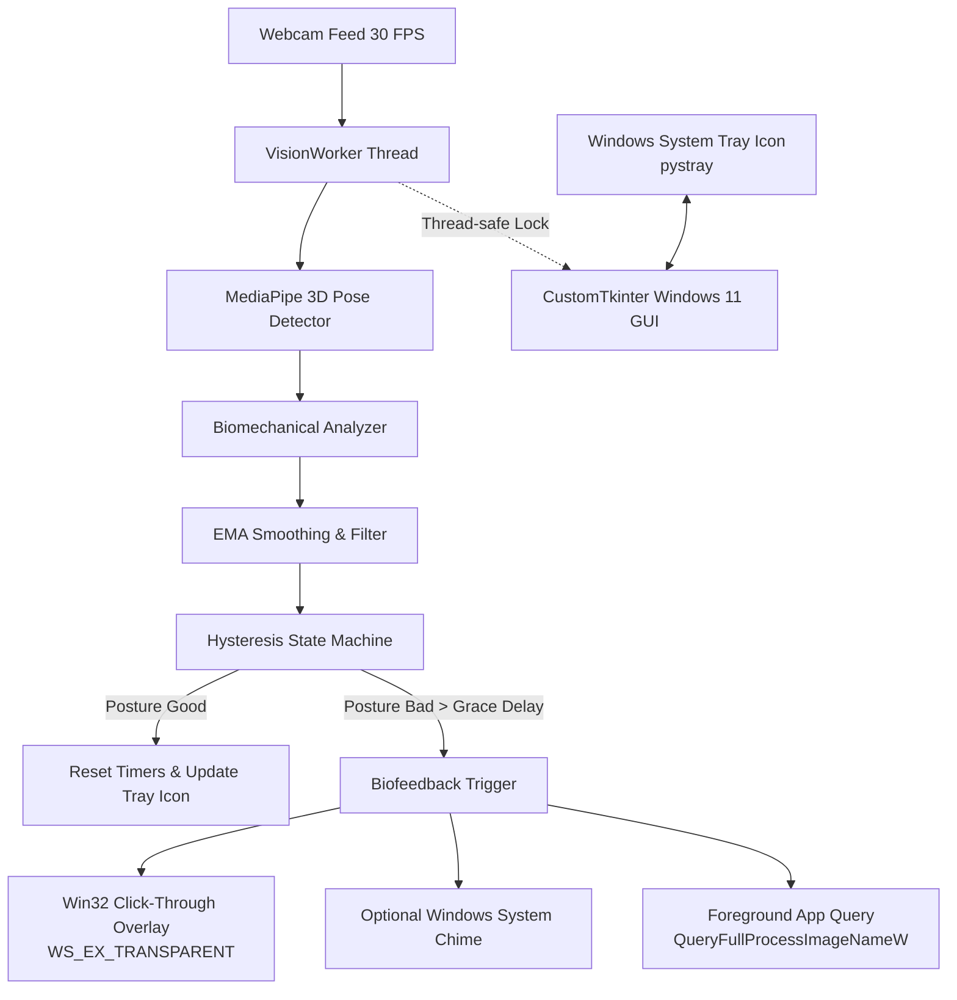

# Posture Guardian 🛡️

[](https://www.microsoft.com/windows)
[](https://www.python.org/)
[](https://developers.google.com/mediapipe)
[](https://github.com/TomSchimansky/CustomTkinter)
[](LICENSE)

**Posture Guardian** is an intelligent, privacy-first Windows desktop application engineered for continuous workplace posture monitoring and real-time screen biofeedback. Powered by 3D computer vision and deep Win32 API integration, it observes your head, neck, and shoulder alignment through your webcam and gently dims or blurs your screen whenever you slouch—**without stealing keyboard focus or interrupting your typing and mouse clicks.**

---

## 🌟 Key Highlights

- **🧠 3D Biomechanical Pose Engine**: Tracks scale-invariant spinal compression, 3D Z-depth forward head jut ("text neck"), and composite shoulder tilt using Google MediaPipe.
- **✨ Zero-Disruption Desktop Biofeedback**: Full-screen, click-through overlay (`WS_EX_TRANSPARENT | WS_EX_LAYERED | WS_EX_NOACTIVATE`) that fades in smoothly over all monitors without intercepting clicks or keys.
- **🪟 Authentic Windows 11 Fluent Experience**: Styled with native dark surfaces (`#202020` / `#2b2b2b`), Segoe UI typography, and authentic Desktop Window Manager (DWM) Acrylic blur.
- **🛡️ Smart Activity & Chin-Rest Filtering**: Differentiates between resting your chin on your hand versus natural temporary movements (drinking water, scratching face) via temporal filtering.
- **📊 Passive "Culprit App" Analytics**: Passively logs which active foreground application was open when slouching began, revealing which apps trigger your worst posture habits.
- **🔋 Battery-Conscious Stealth Mode**: Background monitoring throttles to 5 FPS with the camera preview disabled, saving CPU cycles and laptop battery life.
- **🔒 100% Private & Local**: All vision inference and calculations run entirely on-device on your local CPU. No camera feed or biometric telemetry ever leaves your computer.

---

## 🔬 How the Biomechanical Engine Works

Posture Guardian does not rely on simple 2D bounding boxes. Instead, it computes three normalized biomechanical vectors in real time:

| Metric | Biomechanical Principle | Detection Formula |
|---|---|---|
| **Spine Compression Ratio** | Distance between mid-ear and mid-shoulder, normalized by shoulder span. Scale-invariant regardless of distance from webcam. | `Ratio = (Y_mid_shoulder - Y_mid_ear) / Shoulder_Width` |
| **Forward Head Jut (ΔZ)** | 3D depth differential in camera space between shoulder coronal plane and ear landmark plane. Catches forward "turtle neck". | `ΔZ = Z_world_shoulder - Z_world_ear` |
| **Lateral Lean & Tilt** | Weighted composite of shoulder tilt and head roll angle, preventing tilt cancellation. | `Tilt = 0.65 × abs(Shoulder_Roll) + 0.35 × abs(Head_Roll)` |

### Signal Conditioning & State Machine
1. **Exponential Moving Average (EMA)**: Landmark measurements are filtered with an EMA smoothing factor (α = 0.28) to eliminate webcam noise and high-frequency jitter.
2. **Grace Delay Period**: Configurable countdown (1.0s – 4.0s) prevents alerts during quick stretches or micro-movements.
3. **Hysteresis State Machine**: Requires posture to improve past an exit ratio (0.62) before clearing the warning state, preventing flickering.
4. **Multi-Monitor Virtual Screen**: Coordinates automatically query the Windows Virtual Desktop bounds (`SM_XVIRTUALSCREEN`, `SM_CYVIRTUALSCREEN`) to span seamlessly across multi-display setups.

---

## 🎮 Controls & Shortcuts

Posture Guardian features global Windows hotkeys that work system-wide even when the application is minimized or running behind other programs:

| Action | In Application | Global Shortcut | System Tray Menu |
|---|---|---|---|
| **Calibrate Baseline** | Click **Calibrate baseline** | **`Alt + C`** | Right-click tray → *Calibrate baseline* |
| **Toggle Warning Mode** | Segmented Button (Dimming / Blur) | **`Alt + B`** | — |
| **Hide / Show Camera** | Click **Hide camera** | **`Alt + H`** | Right-click tray → *Hide / Show camera* |
| **Restore Window** | Double-click taskbar icon | — | Right-click tray → *Show Posture Guardian* |
| **Minimize to Tray** | Click **Minimize to tray** or **`X`** | — | — |
| **Exit Application** | Click close tray menu | **`Alt + Q`** | Right-click tray → *Exit* |

---

## 🖥️ System Architecture



---

## 🚀 Getting Started

### Prerequisites
- **Operating System**: Windows 10 or Windows 11 (64-bit)
- **Camera**: Standard built-in laptop webcam or external USB webcam
- **Python**: Version 3.9 to 3.12 (if running from source)

---

### Option 1: Run from Source

1. **Clone the repository**:
   ```bash
   git clone https://github.com/<your-username>/PostureGuardian.git
   cd PostureGuardian
   ```

2. **Create and activate a virtual environment**:
   ```powershell
   python -m venv .venv
   .\.venv\Scripts\activate
   ```

3. **Install dependencies**:
   ```powershell
   pip install -r requirements.txt
   ```

4. **Launch the application**:
   ```powershell
   python main.py
   ```
   *(Or simply double-click `run.bat`)*

> [!NOTE]
> On first launch, the required MediaPipe 3D Pose Landmarker model (`pose_landmarker.task`, ~9.4 MB) is automatically downloaded from Google's official model storage if not present locally.

---

### Option 2: Build a Standalone Executable (.exe)

You can package Posture Guardian into a completely standalone Windows executable with no Python installation required:

```cmd
build_exe.bat
```

The compiled binary will be placed at:
```
dist\PostureGuardian.exe
```

---

## ⚙️ Configuration & Profiles

Settings and user calibrations are automatically persisted to [`posture_profile.json`](file:///c:/Users/usrva/OneDrive/Desktop/Projects/Slouching%20Detector/posture_profile.json):

```json
{
  "baseline_neck_ratio": 0.80802,
  "baseline_z_diff": 0.06240,
  "baseline_lateral_deg": 1.319,
  "slouch_delay_sec": 1.8,
  "use_acrylic_blur": true,
  "max_opacity": 0.72,
  "audio_enabled": true,
  "show_overlay_guides": true
}
```

- **`slouch_delay_sec`**: Grace period before the warning begins to fade in (1.0s – 4.0s).
- **`use_acrylic_blur`**: `true` uses Windows DWM Acrylic Blur; `false` uses pure black dimming overlay.
- **`max_opacity`**: Maximum overlay opacity level (40% to 90%).
- **`audio_enabled`**: Plays a subtle Windows notification sound after 3+ seconds of sustained slouching.
- **`show_overlay_guides`**: Toggles visual biometric posture lines on the camera preview.

---

## 📦 Dependencies

- [`customtkinter`](https://github.com/TomSchimansky/CustomTkinter): Modern, fluent Windows 11 UI components.
- [`mediapipe`](https://github.com/google-ai-edge/mediapipe): High-fidelity 3D human pose tracking.
- [`opencv-python`](https://github.com/opencv/opencv-python): Real-time video capture and frame processing.
- [`pystray`](https://github.com/moses-palmer/pystray): Native Windows system tray integration.
- [`pillow`](https://github.com/python-pillow/Pillow): Dynamic tray icon rendering and thumbnail processing.
- [`pyinstaller`](https://github.com/pyinstaller/pyinstaller): Standalone executable compilation.

---

## 📄 License

This project is licensed under the [MIT License](LICENSE) - feel free to use, modify, and distribute for personal or commercial projects.
